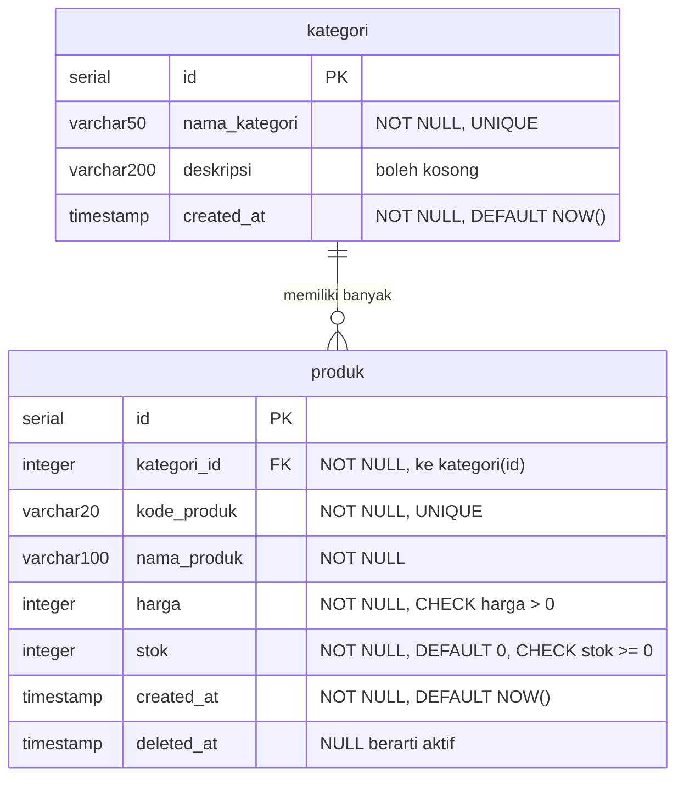

<div align="center">

# 🛒 UTS-PemrogAPI - [namakelompok]

**REST API Toko Online dengan Express.js dan PostgreSQL**

Dua resource one-to-many: `kategori` (hard delete) → `produk` (soft delete)


[🚀 Cara menjalankan](#cara-menjalankan) •
[📋 Endpoint](#daftar-endpoint) •
[🧠 Keputusan desain](#keputusan-desain) •
[🧪 Hasil pengujian](#hasil-pengujian) •
[📚 Dokumentasi](#dokumentasi-tambahan)

</div>

---
## Anggota kelompok

| Nama | NIM | Peran |
| --- | --- | --- |
| [nama] | [nim] | Database dan setup |
| [nama] | [nim] | Kategori (induk) |
| [nama] | [nim] | Produk (anak) |
| [nama] | [nim] | Postman dan error handling |
| [nama] | [nim] | QA dan dokumentasi |

## Teknologi

- Node.js dan Express 5
- PostgreSQL (driver `pg`, memakai `Pool`)
- dotenv untuk konfigurasi
- nodemon (development)
- Postman untuk pengujian

## Cara menjalankan

1. **Prasyarat:** Node.js, npm, dan PostgreSQL sudah terpasang.
2. **Instal dependency:**

   ```bash
   npm install
   ```

3. **Siapkan `.env`** dari contoh, lalu sesuaikan password PostgreSQL:

   ```bash
   copy .env.example .env      # Windows (CMD)
   cp .env.example .env        # macOS / Linux / Git Bash
   ```

   Isi `.env`:

   ```env
   PORT=3000
   DB_HOST=localhost
   DB_PORT=5432
   DB_USER=postgres
   DB_PASSWORD=isi_password_postgres_anda
   DB_NAME=db_uts
   ```

4. **Buat database, tabel, dan data awal:**

   ```bash
   psql -U postgres -f sql/schema.sql
   psql -U postgres -d db_uts -f sql/seed.sql
   ```

   Alternatif: buka pgAdmin, jalankan `CREATE DATABASE db_uts;` secara terpisah, lalu jalankan isi `schema.sql` dan `seed.sql` di Query Tool database `db_uts`.

5. **Jalankan server:**

   ```bash
   npm run dev      # dengan nodemon
   npm start        # tanpa nodemon
   ```

   Server berjalan di `http://localhost:3000`.

6. **Uji dengan Postman:** impor `uts.postman_collection.json` dan environment-nya, pilih environment, lalu jalankan dengan Collection Runner. Panduan: [docs/05-panduan-postman.md](docs/05-panduan-postman.md).

## Rancangan tabel dan relasi



**Relasi:** satu `kategori` memiliki banyak `produk`. Kolom `produk.kategori_id` adalah foreign key ke `kategori(id)` **tanpa** `ON DELETE CASCADE`, sehingga PostgreSQL menolak penghapusan kategori yang masih dirujuk produk (error `23503`).

## Struktur project

```text
api-uts/
├── .env.example
├── .gitignore
├── package.json
├── README.md
├── docs/                      (dokumentasi tambahan)
├── sql/
│   ├── schema.sql
│   └── seed.sql
└── src/
    ├── app.js                 (menyusun aplikasi)
    ├── server.js              (hanya listen)
    ├── config/db.js           (pg Pool, dibuat sekali)
    ├── routes/                (kategoriRoutes.js, produkRoutes.js)
    ├── middlewares/           (parseId.js, validateKategori.js, validateProduk.js)
    ├── controllers/           (kategoriController.js, produkController.js)
    └── repositories/          (kategoriRepository.js, produkRepository.js)
```

Alur satu request: **route → middleware (parseId, validasi) → controller → repository → PostgreSQL**. Seluruh SQL hanya ada di repository dan semua query memakai parameter (`$1`, `$2`, ...).

## Format respons

Sukses:

```json
{ "status": "success", "message": "...", "data": {} }
```

Daftar menambahkan `count`. Soft delete dan hard delete yang berhasil mengirim `204` tanpa body.

Gagal:

```json
{ "status": "error", "message": "...", "errors": ["..."] }
```

Field `errors` hanya muncul pada kegagalan validasi. URL tidak dikenal dibalas `404` dengan message `Route tidak ditemukan`. Error server dibalas `500` dengan pesan umum, dan detail error hanya dicetak ke console server.

## Daftar endpoint

Base URL: `http://localhost:3000`

### Kategori (induk, hard delete)

| Method | URL | Fungsi | Status |
| --- | --- | --- | --- |
| GET | `/api/kategori` | Daftar semua kategori | 200 |
| GET | `/api/kategori/:id` | Detail satu kategori | 200, 400, 404 |
| POST | `/api/kategori` | Tambah kategori | 201, 400, 409 |
| DELETE | `/api/kategori/:id` | Hard delete kategori | 204, 400, 404, 409 |

### Produk (anak, soft delete)

| Method | URL | Fungsi | Status |
| --- | --- | --- | --- |
| GET | `/api/produk` | Daftar produk aktif beserta `count` | 200 |
| GET | `/api/produk/:id` | Detail satu produk aktif | 200, 400, 404 |
| GET | `/api/kategori/:id/produk` | Produk aktif milik satu kategori | 200, 400, 404 |
| POST | `/api/produk` | Tambah produk | 201, 400, 409, 422 |
| PUT | `/api/produk/:id` | Ganti seluruh data (semua field wajib) | 200, 400, 404, 409, 422 |
| PATCH | `/api/produk/:id` | Ubah sebagian field | 200, 400, 404, 409, 422 |
| DELETE | `/api/produk/:id` | Soft delete | 204, 400, 404 |
| PATCH | `/api/produk/:id/restore` | Pulihkan produk yang di-soft delete | 200, 400, 404 |
| DELETE | `/api/produk/:id/permanent` | *(nilai tambah)* hard delete produk yang sudah di-soft delete | 204, 400, 404, 409 |
| GET | `/api/produk?kategori_id=1` | *(nilai tambah)* filter produk per kategori | 200, 400 |

Spesifikasi lengkap (aturan validasi, arti tiap status): [docs/04-spesifikasi-api.md](docs/04-spesifikasi-api.md).

### Contoh body dan respons

**POST `/api/kategori`**

```json
{ "nama_kategori": "Elektronik", "deskripsi": "Perangkat elektronik" }
```

Respons `201`:

```json
{
  "status": "success",
  "message": "Kategori berhasil ditambahkan",
  "data": {
    "id": 1,
    "nama_kategori": "Elektronik",
    "deskripsi": "Perangkat elektronik",
    "created_at": "2026-11-26T10:00:00.000Z"
  }
}
```

**POST `/api/produk`**

```json
{
  "kategori_id": 1,
  "kode_produk": "ELK-001",
  "nama_produk": "Mouse Wireless",
  "harga": 85000,
  "stok": 20
}
```

Respons `201`:

```json
{
  "status": "success",
  "message": "Produk berhasil ditambahkan",
  "data": {
    "id": 1,
    "kategori_id": 1,
    "kode_produk": "ELK-001",
    "nama_produk": "Mouse Wireless",
    "harga": 85000,
    "stok": 20,
    "created_at": "2026-11-26T10:00:00.000Z",
    "deleted_at": null
  }
}
```

**PUT `/api/produk/1`** (semua field wajib)

```json
{
  "kategori_id": 1,
  "kode_produk": "ELK-001",
  "nama_produk": "Mouse Wireless Pro",
  "harga": 99000,
  "stok": 15
}
```

**PATCH `/api/produk/1`** (cukup field yang berubah, minimal satu)

```json
{ "stok": 40 }
```

**GET `/api/produk`** respons `200`:

```json
{
  "status": "success",
  "message": "Daftar produk berhasil diambil",
  "count": 1,
  "data": [ { "id": 1, "kode_produk": "ELK-001", "deleted_at": null } ]
}
```

**Contoh respons gagal (validasi)** `400`:

```json
{
  "status": "error",
  "message": "Validasi gagal",
  "errors": ["harga harus bilangan bulat > 0", "stok harus bilangan bulat >= 0"]
}
```

## Keputusan desain

### 1. Mengapa ada PUT dan PATCH

- **PUT** mengganti **seluruh** representasi produk. Semua field wajib dikirim, dan kalau ada yang kurang API membalas `400`. Dengan begitu hasil PUT selalu pasti: data akhir sama dengan body yang dikirim, dan mengirim request yang sama berulang kali menghasilkan keadaan yang sama (idempoten).
- **PATCH** mengubah **sebagian** field. Cocok untuk kasus yang sering terjadi, misalnya hanya memperbarui `stok` atau `harga`, tanpa mengirim ulang semua data. Field yang tidak dikirim tidak berubah, dan body kosong `{}` ditolak `400`.
- Keduanya memakai aturan validasi yang sama. Perbedaannya hanya pada apakah semua field wajib (middleware `validateProduk`) atau hanya field yang dikirim (`validatePatch`).

### 2. Perilaku soft delete terhadap UNIQUE

`kode_produk` tetap `UNIQUE` pada seluruh baris, **termasuk** baris yang sudah di-soft delete. Memakai kembali kode milik produk yang sudah dihapus tetap dibalas `409 Conflict`. Alasannya:

- Kode produk adalah identitas bisnis. Kode lama bisa masih tercatat di riwayat transaksi, sehingga memakainya kembali untuk barang lain membingungkan.
- Restore selalu aman. Jika kode boleh dipakai ulang, restore produk lama bisa bentrok dengan produk aktif yang memakai kode yang sama.
- Sesuai ketentuan soal: constraint `UNIQUE` pada skema tidak diubah.

Konsekuensinya, kode milik produk yang dihapus "terkunci" sampai baris tersebut dihapus permanen.

### 3. Perilaku soft delete terhadap foreign key

Produk yang di-soft delete masih berisi `kategori_id`, sehingga masih merujuk kategorinya. Akibatnya **hard delete kategori tetap ditolak `409`** selama masih ada produk di bawahnya, aktif maupun sudah di-soft delete. Ini disengaja, karena integritas data dijaga oleh foreign key di database, bukan oleh kode aplikasi, dan foreign key sengaja dibuat tanpa `ON DELETE CASCADE`.

Agar kategori bisa dihapus, produk di bawahnya harus dibersihkan lebih dulu. *(Jika nilai tambah dikerjakan:)* hapus permanen lewat `DELETE /api/produk/:id/permanent`. Endpoint itu hanya berlaku untuk produk yang sudah di-soft delete, sedangkan produk aktif ditolak `409`.

### 4. Mengapa hard delete pada tabel induk

- `kategori` hanya pengelompokan. Ia tidak punya nilai riwayat, dan tabelnya tidak memiliki kolom `deleted_at`.
- Hard delete aman karena foreign key melindunginya: kategori yang masih punya produk tidak akan pernah terhapus (`409`), jadi tidak ada produk "yatim".
- Data yang bernilai riwayat, yaitu produk (harga, stok, kode), dilindungi dengan soft delete.

### 5. Pemetaan kode error PostgreSQL

| Kode PG | Arti | Terjadi saat | Status API |
| --- | --- | --- | --- |
| `23505` | UNIQUE violation | POST/PUT/PATCH dengan `nama_kategori` atau `kode_produk` kembar | `409` |
| `23503` | FOREIGN KEY violation | Hapus kategori yang masih dirujuk produk | `409` |
| `23503` | FOREIGN KEY violation | POST/PUT/PATCH produk dengan `kategori_id` yang tidak ada | `422` |
| lainnya | Error tak terduga | Apa pun | `500` (pesan umum, detail di console) |

Kode `23503` sama, tetapi statusnya berbeda karena operasinya berbeda. Penanganan dilakukan di controller masing-masing operasi, bukan di handler global.

## Hasil pengujian

Tangkapan layar ada di folder `docs/screenshots/`:

- Hasil Collection Runner Folder 1 dan Folder 2
- Bukti database: setelah S07, setelah S10, setelah S14

## Dokumentasi tambahan

| Dokumen | Isi |
| --- | --- |
| [01-pemahaman-soal](docs/01-pemahaman-soal.md) | Ringkasan permintaan dosen dan poin nilai |
| [02-pembagian-peran](docs/02-pembagian-peran.md) | Pembagian tugas 5 anggota |
| [03-jebakan-dan-solusi](docs/03-jebakan-dan-solusi.md) | Jebakan di soal dan kode contoh, beserta solusinya |
| [04-spesifikasi-api](docs/04-spesifikasi-api.md) | Aturan validasi, status code, format respons |
| [05-panduan-postman](docs/05-panduan-postman.md) | Struktur collection dan skrip test |
| [06-checklist-qa-celah](docs/06-checklist-qa-celah.md) | Skenario uji tambahan |
| [07-checklist-pengumpulan](docs/07-checklist-pengumpulan.md) | Daftar cek sebelum submit |
